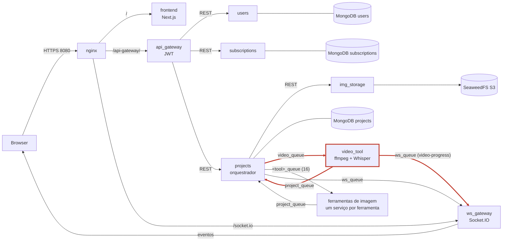
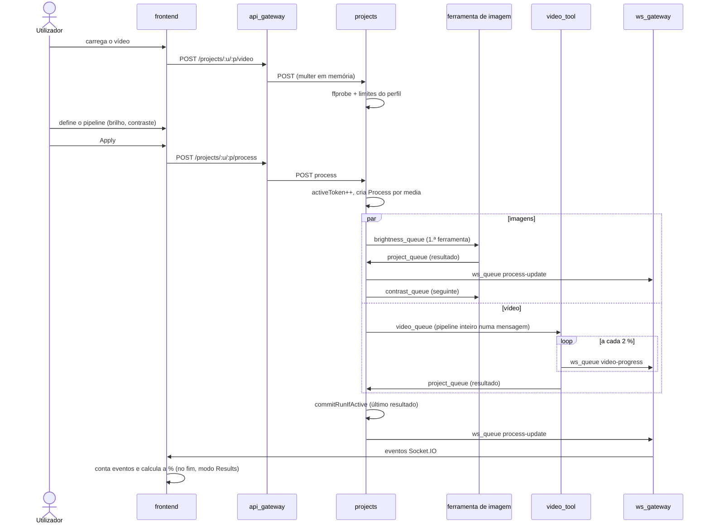

# Fase 2 — Padrões arquiteturais, alternativas e cenários de qualidade

Resolução do Exercício 6 (Blocos 1 e 2, enunciados v1.1). Completa o `diagnostico.md`, que já
contém as fragilidades com evidência (candidatos C1 a C8), sem as repetir: aqui fica a leitura
arquitetural (padrões, vistas, alternativas) e a passagem das fragilidades a cenários de qualidade
e a requisitos candidatos. As táticas e as decisões estão em `taticas.md` (Exercício 7).

| Campo | Valor |
| --- | --- |
| Commit de partida | `052310226c51fa57a17101c7bd1ad795674aac95` (`0523102`) de `picturas-um/picturas-27`; `43a2e08` no nosso repositório |
| Evidência | Leitura do código e da configuração nesse commit; medições da base em `medicoes/baseline/` |
| Notação | `EV-nn`: facto verificado (código, configuração ou medição). `H-nn`: hipótese, ainda não verificada |

## 1. Âmbito e vista da arquitetura

### 1.1 Vista de contentores, com o caminho do vídeo destacado

A traço grosso, o caminho do vídeo na base. Todas as filas são do exchange direto `picturas`
(`rabbitMQ/definitions.json`).

### 1.2 Sequência de um pedido completo na base (projeto com imagens e um vídeo)

### 1.3 Onde imagem e vídeo bifurcam

| Ponto | Imagem | Vídeo | Evidência |
| --- | --- | --- | --- |
| Carregamento | `POST .../img` | `POST .../video`, com `ffprobe` e limites de duração e tamanho por perfil | EV-01 |
| Despacho | Uma mensagem por ferramenta, para a fila da ferramenta | Uma mensagem com o pipeline inteiro (`tool_name = "video"`, `params.tools = videoPipeline(...)`) | EV-02 |
| Progresso | O browser conta eventos `process-update` | O worker publica `video-progress` direto na `ws_queue` | EV-03, EV-04 |
| Ferramentas | As 16 de imagem | Subconjunto que o `video_tool` reimplementa (`apply_frame_effects`), mais corte, velocidade, legendas e extração de fotogramas | EV-05 |

## 2. Padrões atuais

### 2.1 Padrão global

**Microserviços com API Gateway, comunicação assíncrona por eventos (RabbitMQ) e orquestração
central no `projects`.** Dentro de cada serviço Node, camadas rotas → controladores → modelos.

| Elemento do padrão | Evidência |
| --- | --- |
| Entrada única por reverse proxy | `nginx/nginx.conf`: `/` → frontend, `/api-gateway/` → api_gateway, `/socket.io` → ws_gateway (EV-06) |
| API Gateway com autenticação | `apiGateway/auth/auth.js:3-12` (`jwt.verify`); o gateway passa o pedido aos serviços (EV-07) |
| Serviços com base de dados própria | Três MongoDB em `docker-compose.yaml` (`projects_mongoDB`, `users_mongoDB`, `subscriptions_mongoDB`) (EV-08) |
| Event-driven, ponto a ponto | 20 filas ligadas ao exchange `picturas` (`rabbitMQ/definitions.json`) (EV-09) |
| Orquestração central | O `projects` decide a ferramenta seguinte de cada imagem e fecha a execução (`commitRunIfActive`) (EV-10) |
| Pipes and filters distribuído | Uma ferramenta de imagem por contentor, encadeadas pelo orquestrador (EV-11) |

**Benefícios.** Isolamento de falhas por ferramenta; cada ferramenta escala e evolui sozinha; o
cliente não espera pelo processamento (assíncrono).
**Desafios.** O estado de uma execução fica espalhado (Process no MongoDB, mensagens nas filas,
contagem no browser); uma ligação AMQP por mensagem publicada (`projects/utils/rabbit_mq.js`);
os serviços confiam no cabeçalho `X-Caller-Id` posto pelo gateway e muitas rotas do `projects`
não confirmam o dono (diagnóstico, C6).

### 2.2 Padrão do processamento de vídeo

**Pipeline monolith num worker único sobre uma fila** (`video_tool`): o pipeline inteiro de um
vídeo segue numa mensagem e é aplicado num só processo, que descodifica uma vez e codifica uma vez.

| Elemento | Evidência |
| --- | --- |
| Uma mensagem por vídeo com o pipeline completo | `projects/routes/projects.js:1634-1642` (EV-02) |
| Consumidor único, um trabalho de cada vez | `Tools/video/video.py:55` (`prefetch_count=1`); sem `deploy.replicas` no `docker-compose.yaml` (EV-12) |
| Todos os efeitos, legendas e fotogramas no mesmo serviço | `Tools/video/` (`effects.py`, `subtitles.py`, `frame_extraction.py`) (EV-05) |
| Progresso fora do orquestrador | `video.py:112-124` publica na `ws_queue` (EV-04) |

**Benefícios.** Uma só descodificação e codificação (sem perda de qualidade nem custo de disco
intermédio entre efeitos); nenhuma saída parcial se falhar a meio.
**Desafios.** Vídeos processados um de cada vez no sistema inteiro (diagnóstico, C3); os efeitos
de imagem são reimplementados (C2); o progresso não passa pelo orquestrador, por isso ninguém o
guarda (C4).

### 2.3 Relação entre os dois

| Aspeto | Segue / afasta-se | Consequência |
| --- | --- | --- |
| Comunicação por filas e resultado no `project_queue` | Segue | Reutiliza o fecho da execução (`commitRunIfActive`) e o cancelamento por token |
| Um serviço por filtro | Afasta-se (um serviço para tudo) | Justificado pelo custo de codificar o vídeo entre filtros; custa modularidade (C2) |
| Orquestração central | Afasta-se em parte: o orquestrador despacha e recebe o resultado, mas não vê o progresso | O estado intermédio da execução não existe no servidor: origem da fragilidade do RNF-F2-02 |
| Escala por réplicas | Igual no papel (o padrão permite réplicas), mas não configurado | Capacidade de um vídeo de cada vez (C3) |

## 3. Matriz de comparação de padrões

Escala: ↑ bom, ~ médio, ↓ fraco. Alternativas para o vídeo:
**A1 — Competing Consumers** (N réplicas do `video_tool` sobre a mesma fila, filas separadas
para a legendagem); **A2 — um microserviço por efeito de vídeo** (pipes and filters distribuído,
como as imagens); **A3 — tarefas efémeras por vídeo** coordenadas por um orquestrador de
workflow. Termo de comparação global: **Modular Monolith**.

| Atributo (ISO/IEC 25010) | Global atual | Vídeo atual | A1 | A2 | A3 | Modular Monolith |
| --- | --- | --- | --- | --- | --- | --- |
| Relação com o global | — | Afasta-se em parte | Mantém | Mantém (é o global) | Altera em parte | Altera |
| Desempenho — comportamento temporal | ~ latência das filas, assíncrono | ↑ por vídeo (uma codificação) | ↑ igual por vídeo | ↓ codifica entre cada efeito | ~ arranque de cada tarefa | ↑ sem rede interna |
| Desempenho — capacidade/elasticidade | ↑ escala por serviço | ↓ um vídeo de cada vez (EV-12) | ↑ N em paralelo | ~ escala por efeito | ↑ elástico | ↓ escala em bloco |
| Desempenho — utilização de recursos | ~ ~25 contentores | ~ | ↓ N cópias do modelo Whisper em memória | ↓ disco intermédio por efeito | ~ | ↑ |
| Fiabilidade — tolerância/recuperabilidade | ↑ falhas isoladas | ~ sem saída parcial, mas o progresso perde-se (C4, C7) | ↑ uma réplica cai, as outras continuam | ~ mais pontos de falha | ↑ repetição por tarefa | ↓ uma falha derruba tudo |
| Manutenibilidade — modularidade/modificabilidade | ↑ | ↓ efeitos reimplementados (C2) | ~ igual ao atual | ↑ reutiliza as ferramentas de imagem | ~ mais infraestrutura | ~ |
| Segurança | ~ JWT só no gateway; confiança em `X-Caller-Id` (C6) | ~ igual | ~ igual | ~ mais superfície | ↓ acesso ao Docker/orquestrador | ↑ menos superfície |
| Usabilidade — operabilidade | ↓ progresso e estado só no browser (C4) | ↓ | ~ menos espera em fila; não resolve o estado | ~ | ↑ o orquestrador de workflow guarda o estado | ~ |

Justificação: cada célula assenta nas evidências da secção 2 e no diagnóstico (C2 a C7). As
avaliações de A1 a A3 são **hipóteses** (H-01 a H-03), porque nenhuma foi implementada nem medida.

## 4. Trade-offs

| Atributo | Depende sobretudo de | Pré-requisitos e efeitos colaterais |
| --- | --- | --- |
| Desempenho — recursos (carregamento) | Padrão global: cada serviço do caminho guardava o ficheiro inteiro em memória (C5, EV-13) | Mudar para fluxo melhora recursos e tempo de aceitação, mas obriga a validar depois de guardar (risco de objetos órfãos, controlo C1.7) |
| Desempenho — capacidade | Padrão do vídeo (consumidor único) | A1 melhora a capacidade e degrada a memória (um modelo Whisper por réplica) |
| Fiabilidade — recuperabilidade | Interação: o vídeo não reporta ao orquestrador | Guardar o estado no servidor é pré-requisito de qualquer melhoria de operabilidade (requisitos-nf, 3.5) |
| Manutenibilidade | Padrão do vídeo | A2 melhora a modularidade e degrada o tempo (codificar entre efeitos) |
| Segurança | Padrão global (confiança no gateway) | Endurecer a autenticação entre serviços melhora a segurança e acrescenta latência e configuração |
| Usabilidade — operabilidade | Interação (estado só no browser) | Mostrar o estado em qualquer página exige o pré-requisito de fiabilidade acima e mais mensagens (efeito em desempenho, controlo C2.1) |

## 5. Cenários de qualidade

| ID | Fonte | Estímulo | Artefacto | Ambiente | Resposta | Medida da resposta |
| --- | --- | --- | --- | --- | --- | --- |
| QS-01 | Utilizador premium | Carrega um vídeo de 1000 MiB | Caminho de carregamento (nginx, api_gateway, projects, img_storage) | Operação normal, um envio de cada vez | O ficheiro é aceite sem que a memória acompanhe o tamanho | Acréscimo de memória por serviço (MiB, M1.1); maior ficheiro aceite com 512 MiB por contentor (M1.2) |
| QS-02 | Utilizador registado ou premium | Recarrega a página, muda de página ou abre outra sessão a meio de uma execução de minutos | Frontend, `projects`, `ws_gateway`, `video_tool` | Execução de P em curso (vídeo de 330 s e duas imagens) | Continua a usar a aplicação, vê o progresso de P e pode cancelá-lo | % de 10 ações concluídas (M2.1); tempo até o estado reaparecer e até à notificação de fim (M2.2, s); % de cancelamentos conseguidos (M2.3) |
| QS-03 | Dois utilizadores | Submetem a legendagem de um vídeo longo e um efeito num vídeo curto | `video_tool`, `video_queue` | Carga com 2 trabalhos | O vídeo curto não espera pelo longo | Tempo até ao resultado do vídeo curto (s) |
| QS-04 | `video_tool` | Falha a meio de um lote | Worker, `projects` | Operação normal | O pedido não se perde e não há saída parcial | Tempo de recuperação; pedidos perdidos |
| QS-05 | Atacante sem JWT | Envia 500 MiB à API | `nginx`, `api_gateway` | Operação normal | O pedido é recusado antes de ser lido | Código da resposta; memória do gateway (C1.3) |

**Prioridade** (importância para os stakeholders × dificuldade): 1. QS-02 (todas as execuções de
todos os utilizadores; base 0%); 2. QS-01 (o gateway era terminado com 500 MiB e o Docker parava
com 1000 MiB); 3. QS-05 (efeito do QS-01); 4. QS-03; 5. QS-04.

Atributos por prioridade: **1. Usabilidade (operabilidade), 2. Eficiência de desempenho
(utilização de recursos), 3. Segurança, 4. Eficiência de desempenho (capacidade), 5. Fiabilidade.**

## 6. Candidatos a RNF da Fase 2

| # | Característica / subcaracterística | Fragilidade (evidência) | Origem | Pertinência | Complexidade | Escala e método | Pré-requisitos / efeitos |
| --- | --- | --- | --- | --- | --- | --- | --- |
| CAND-1 (RNF-F2-01) | Eficiência de desempenho — utilização de recursos | Cópias completas do ficheiro em memória em cada serviço (C5, EV-13) | Padrão global (cada serviço usa `multer` em memória) | Alta: a operação perde serviços; o premium não consegue carregar 1 GB | Alta: quatro serviços, validação sobre o objeto guardado | MiB por serviço com `docker stats` (M1.1); maior ficheiro com 512 MiB (M1.2) | Efeitos em tempo (C1.1, C1.2), segurança (C1.3) e correção (C1.4, C1.5) |
| CAND-2 (RNF-F2-02) | Usabilidade — operabilidade | Painel bloqueante e estado só no browser (C4, EV-03, EV-04, EV-14) | Interação: o vídeo não reporta ao orquestrador | Alta: todos os utilizadores, todas as execuções | Média–alta: orquestrador, worker, gateway de WebSocket e frontend | Script Playwright (M2.1, M2.2, M2.3) | Pré-requisito de fiabilidade (estado no servidor); efeitos em tempo (C2.1), atualização do progresso (C2.2), segurança (C2.3), correção (C2.4, C2.5) |

A especificação completa está em `requisitos-nf.md`.

## 7. Registo de evidências e hipóteses

| ID | Tipo | Conteúdo | Onde |
| --- | --- | --- | --- |
| EV-01 | Facto | Rota de carregamento de vídeo com `ffprobe` e limites por perfil | `projects/routes/projects.js:1277-1351`, `projects/utils/video.js:115` |
| EV-02 | Facto | Vídeo despachado com o pipeline inteiro numa mensagem | `projects/routes/projects.js:1634-1642` |
| EV-03 | Facto | Estado "a processar" num `useState` da página; progresso das imagens contado no browser | `frontend/app/dashboard/[pid]/page.tsx:89`, `301-315` |
| EV-04 | Facto | Progresso do vídeo publicado direto na `ws_queue`, a cada 2 % | `Tools/video/video.py:112-124`; `video_processor.py:221` |
| EV-05 | Facto | Efeitos, legendas e fotogramas no mesmo worker | `Tools/video/` |
| EV-06 | Facto | Entrada única pelo nginx | `nginx/nginx.conf:24-65` |
| EV-07 | Facto | JWT verificado no api_gateway | `apiGateway/auth/auth.js:3-12` |
| EV-08 | Facto | Uma base de dados por serviço | `docker-compose.yaml` |
| EV-09 | Facto | 20 filas no exchange `picturas` | `rabbitMQ/definitions.json` |
| EV-10 | Facto | Fecho da execução pelo orquestrador | `projects/routes/projects.js` (`commitRunIfActive`) |
| EV-11 | Facto | Uma ferramenta de imagem por contentor | `docker-compose.yaml` (`*_tool`) |
| EV-12 | Facto | Worker de vídeo único, `prefetch_count=1` | `Tools/video/video.py:55`, `docker-compose.yaml:256-273` |
| EV-13 | Medição | Acréscimo de 2001 MiB no `api_gateway` com 500 MiB; motor do Docker em baixo com 1000 MiB | `medicoes/baseline/resumo.md` |
| EV-14 | Medição | M2.1 = 0 %, M2.2 sem recuperação, M2.3 = 0/10; maior intervalo do progresso 16,9 s | `medicoes/baseline/resumo.md` |
| H-01 | Hipótese | A1 dá ganhos de capacidade proporcionais aos núcleos e multiplica a memória do Whisper | Não medido |
| H-02 | Hipótese | A2 aumenta o tempo por codificar entre efeitos | Não medido |
| H-03 | Hipótese | A3 exige acesso ao Docker ou a um orquestrador externo | Não medido |

## 8. Conclusões e recomendações

- **Adequação.** O padrão global é adequado ao PictuRAS (isola ferramentas, assíncrono). O
  padrão do vídeo é adequado ao custo de codificação, mas afasta-se do global em dois pontos que
  geram fragilidades: o progresso não passa pelo orquestrador (operabilidade) e não há réplicas
  (capacidade).
- **Otimizações escolhidas para a Fase 2.** CAND-1 e CAND-2 (`taticas.md`, ADR-01, ADR-02).
- **Evolução futura (fora do âmbito, por serem outros RNF).** Réplicas do `video_tool` e fila
  dedicada à legendagem (QS-03); confiança entre serviços e verificação do dono em todas as rotas
  do `projects` (C6); recuperação de trabalhos interrompidos (QS-04); uma ligação AMQP duradoura.
- **Preservação funcional.** Testes existentes (`Tools/video/tests`, `projects/tests`) e a suite
  de regressão da Fase 2 (`requisitos-nf.md`, 4.4) correm antes e depois de cada passo.

## 9. Utilização de IA

Ver `ia.md`. Neste documento, o agente de IA leu o código no commit de partida e propôs as tabelas
e os diagramas; a equipa confirmou cada referência (ficheiro e linha) e cada medição contra
`medicoes/baseline/`, e marcou como hipótese tudo o que não foi medido.
