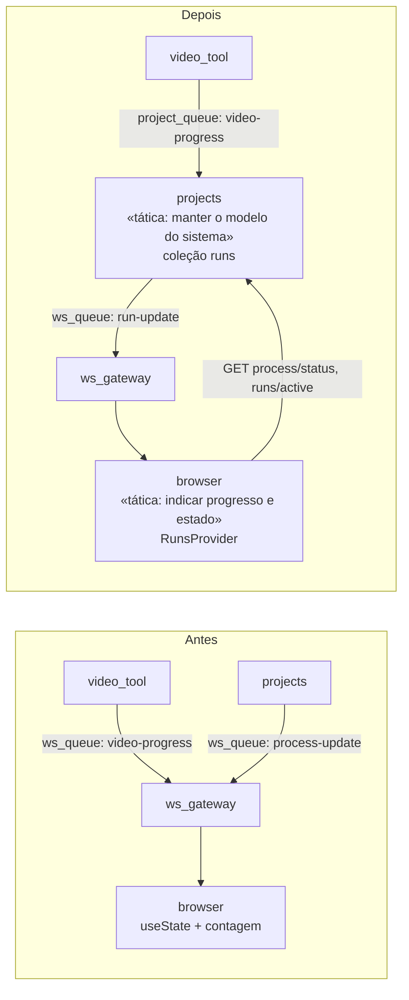

# Fase 2 — Táticas arquiteturais e decisões

Resolução do Exercício 7 (enunciado v3.0). Parte dos dois cenários e candidatos de
`arquitetura.md` (secções 5 e 6), sem os reescrever, e continua a numeração das evidências e
hipóteses (`EV-nn`, `H-nn`). As decisões estão descritas em pormenor no ADR-01 e no ADR-02.

```
EV/H (arquitetura.md §7) → CAND (§6) → QS (§5) → TAT (aqui) → DA (aqui, ADR-01, ADR-02)
```

## 1. Cenários de entrada

| Cenário | Candidato | Característica | Estímulo | Resposta a obter | Evidência |
| --- | --- | --- | --- | --- | --- |
| QS-01 | CAND-1 (RNF-F2-01) | Eficiência de desempenho — utilização de recursos | Envio de um vídeo de 1000 MiB | Memória de cada serviço limitada por um valor fixo | EV-13 |
| QS-02 | CAND-2 (RNF-F2-02) | Usabilidade — operabilidade | Recarregar, mudar de página ou abrir outra sessão a meio de uma execução | Continuar a usar a aplicação, ver o progresso e cancelar | EV-03, EV-04, EV-14 |

Escala, método, base, alvo e mínimo: `requisitos-nf.md`, secções 2.3 e 3.4.

## 2. Táticas candidatas

### 2.1 QS-01 (desempenho — gerir recursos e controlar a procura)

| ID | Tática (categoria) | Como produz a resposta | Já existe na base? | Classe |
| --- | --- | --- | --- | --- |
| TAT-1 | Aumentar a eficiência dos recursos: processar em fluxo (controlar a procura) | Os bytes passam por cada serviço em blocos; a memória fica limitada pelos buffers | Não: `multer.memoryStorage()` no `api_gateway`, `projects` e `img_storage` (EV-13) | A |
| TAT-2 | Reduzir a sobrecarga: retirar intermediários do caminho dos bytes (URL assinado, envio direto ao S3) | Nenhum serviço da aplicação vê os bytes | Não | A no utilizador, mas muda o contrato da API e o frontend; piora a segurança (C6) |
| TAT-3 | Limitar o tamanho/tempo da procura: limites de memória e de tamanho por contentor | Impede que um envio derrube o Docker | Em parte: limite de 1100 MB no nginx | A, mas não cumpre o enunciado (o ficheiro continua inteiro em memória até ao limite) |
| TAT-4 | Aumentar recursos | Mais memória por contentor | — | A, mas só adia o problema; não muda a escala |

### 2.2 QS-02 (usabilidade — apoiar a iniciativa do sistema e do utilizador)

| ID | Tática (categoria) | Como produz a resposta | Já existe na base? | Classe |
| --- | --- | --- | --- | --- |
| TAT-5 | Manter o modelo do sistema: o estado e o progresso de cada execução guardados e expostos pelo orquestrador (iniciativa do sistema) | A interface reconstrói o estado a partir do servidor depois de recarregar ou noutra sessão | Não: o estado vive num `useState` (EV-03) e o progresso do vídeo não é guardado (EV-04) | A (o utilizador não vê o mecanismo) |
| TAT-6 | Indicar progresso e estado em qualquer página, sem bloquear (iniciativa do sistema) | Progresso na barra lateral e na página do projeto; aviso de fim, cancelamento ou falha com o nome do projeto | Em parte: progresso existia, mas num painel bloqueante e só na página do projeto | B: muda a interação só para melhorar a operabilidade; não acrescenta capacidades |
| TAT-7 | Cancelar (iniciativa do utilizador), disponível depois de perder a página | O botão aparece sempre que a execução está ativa, a partir do estado do servidor | Sim, o cancelamento existe, mas só no painel e só antes de recarregar | A/B: a capacidade já existia; muda só quando está disponível |
| TAT-8 | Manter o modelo do sistema só no browser (`localStorage`) | O browser lembra-se da execução depois de recarregar | Não | A, mas falha a forma B da M2.3 (outra sessão) e não sabe o progresso real do servidor |
| TAT-9 | Polling periódico do estado, sem push | O browser pergunta o estado a cada N s | Não | A, mas atraso até N s, mais carga no `projects` e pior C2.2 |
| TAT-10 | Pausar/retomar uma execução | — | Não | **C — rejeitada**: capacidade nova |

## 3. Decisões arquiteturais

### DA-1 — Carregamento em fluxo de ponta a ponta (TAT-1)

Motivação: QS-01, CAND-1, EV-13. Decisão completa, com as alternativas A, B e C, no
`adr/ADR-01-carregamento-em-fluxo.md`. Resumo: TAT-1 com validação sobre o objeto guardado.
Rejeitadas: TAT-2 (muda o contrato da API e expõe escrita direta no armazenamento), TAT-3 e TAT-4
(não mudam a relação entre memória e tamanho). Elementos afetados: `nginx`, `api_gateway`,
`projects`, `img_storage`. Estrutura que a realiza: *pipes and filters* em fluxo (streams).

### DA-2 — Estado da execução no orquestrador, com progresso enviado por push (TAT-5 + TAT-6 + TAT-7)

Motivação: QS-02, CAND-2, EV-03, EV-04, EV-14. Decisão completa no
`adr/ADR-02-estado-da-execucao-no-orquestrador.md`.

- **Contexto.** O orquestrador despacha e fecha as execuções, mas não sabe em que ponto estão: o
  progresso do vídeo vai do worker diretamente para o browser e o das imagens é contado no browser.
- **Alternativas rejeitadas.** TAT-8 (falha a sessão nova, M2.3 B); TAT-9 sozinha (atraso e
  carga; fica só como recurso quando um evento se perde); guardar o estado no documento `Project`
  (cada atualização mudaria a versão do projeto e criaria conflitos com edições do pipeline e com
  o RNF-F2-01); TAT-10 (classe C).
- **Decisão.** Coleção `runs` no `projects`, com o estado e o progresso ponderado de cada
  execução; o worker de vídeo passa a reportar ao `project_queue` em vez da `ws_queue`; o
  `projects` publica cada mudança (`run-update`) pelo `ws_gateway` e expõe duas rotas de leitura;
  o frontend troca o painel bloqueante por indicadores não bloqueantes e reconstrói o estado ao
  carregar.
- **Consequências.** (+) Recuperabilidade do estado; o vídeo volta a seguir o padrão global
  (orquestração central). (−) Mais escritas no MongoDB e mais mensagens (uma por 1 % de cada
  vídeo); mais uma coleção a manter coerente com o cancelamento.
- **Elementos afetados.** `projects` (modelo, controlador, rotas, mensagens), `video_tool`,
  `ws_gateway`, `api_gateway` (duas rotas), `frontend` (página do projeto, barras laterais,
  provider). A origem da fragilidade é a interação entre o padrão do vídeo e o global, pelo que o
  refactoring atravessa quatro serviços: risco de regressão médio, controlado pelos testes e pelos
  controlos C2.1 a C2.5.
- **Estrutura que a realiza.** *Publish-subscribe* sobre a `ws_queue` e um registo de estado no
  orquestrador (*state store*).

## 4. Vista antes e depois



A vista antes/depois da DA-1 está no ADR-01, secção 1.1.

## 5. Trade-offs e plano de medição

### 5.1 Matriz de efeitos

| Atributo | DA-1 | DA-2 |
| --- | --- | --- |
| Desempenho — utilização de recursos | Melhora (objeto da decisão) | Neutro a degrada pouco: mais escritas no MongoDB e mensagens |
| Desempenho — comportamento temporal | Melhora a aceitação (C1.1, C1.2) | Neutro esperado; controlo C2.1 (≤ base + 10 %) |
| Usabilidade — operabilidade | Neutro (M2.1 a M2.3 iguais, `analise.md` 4.1) | Melhora (objeto da decisão) |
| Fiabilidade — recuperabilidade | Risco de objetos órfãos (controlo C1.7) | Melhora: o estado sobrevive à perda da página |
| Segurança | Melhora: JWT verificado antes de ler o corpo (C1.3) | Rotas novas verificam o dono ou a partilha (C2.3) |
| Manutenibilidade | Neutro | Melhora: o vídeo passa a reportar ao orquestrador como as imagens |

### 5.2 Interação entre DA-1 e DA-2

Independentes: nenhuma é pré-requisito da outra (`requisitos-nf.md`, 3.5). Único ponto de contacto:
a ação 7 da M2.1 (carregar uma imagem para Q durante a execução) usa o caminho da DA-1. Mexem no
mesmo ficheiro (`projects/routes/projects.js`) em zonas diferentes: aplicar as alterações da DA-2
sobre o ramo da DA-1 não deu conflitos. Sinergia leve: com a DA-1, o carregamento deixa de bloquear
o `projects` durante um envio grande, o que ajuda as ações G1 da M2.1.

### 5.3 Plano de medição e de regressão

- **Medição.** Os mesmos scripts da medição inicial (`medicoes/`): `rnf1/` para a DA-1 e
  `rnf2/medir.mjs` (m21, m22, m23, controlos) para a DA-2, primeiro em cada ramo e depois com os
  dois integrados, com o procedimento de `requisitos-nf.md` e blocos A-B-A para os tempos
  (`analise.md`, secção 5).
- **Regressão.** `projects/tests` (13 testes, incluindo os novos do progresso) e
  `Tools/video/tests` (29 testes) passam no ramo da DA-2; a suite de regressão da Fase 2
  (`requisitos-nf.md`, 4.4) corre no fim de cada passo.
- **Lacunas de teste encontradas.** Não há testes automáticos do frontend nem das rotas do
  `projects` com MongoDB e RabbitMQ; a DA-2 fica coberta pelo script Playwright do RNF-F2-02 e pelos
  controlos C2.3 a C2.5.

## 6. Utilização de IA

Ver `ia.md`. As táticas candidatas foram propostas com apoio de um agente de IA a partir do
catálogo do Anexo A do enunciado e do código; a equipa rejeitou as de classe C, confirmou na base
se cada tática já existia (com ficheiro e linha) e validou as decisões pelos testes e pelas
medições.
